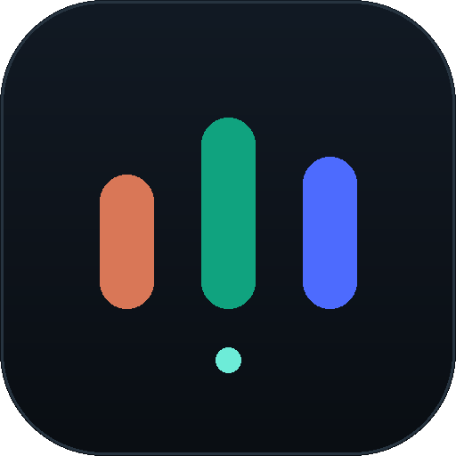

<div align="center">



# Prompt Forge · 提示词工坊

**把一句话需求，按每家模型各自的脾气，写成可以直接粘贴的提示词。**

零依赖 · 本地运行 · 单页 · MIT

</div>

---

## 它是什么

一个**独立的小软件**，不是某个 agent 工程的附属插件。

你写一句需求，它按你选的目标模型，生成一份对应的提示词。可以只出一份，也可以三个模型一起出，三份并排对比——因为**同一句需求，丢给不同的模型，该给的东西完全不一样**。

三个目标之间没有主次，也没有"默认帮另一个模型打下手"。Claude 版不会出现"交给 GPT 处理"，GPT 版也不会假设自己在给 Claude 打前站。它们各自独立，服务于各自的模型。

## 为什么每家的写法不一样

不是文风差异，是能力差异的映射。

| 目标 | 它的脾气 | 你的提示词要写什么 |
| --- | --- | --- |
| **Claude** | 上下文长、格式遵循极强、**会自己补全你没说清的部分** | 七段骨架写死：角色 / 目标 / 输入 / 步骤≤7 / 验收 / 禁区 / 输出。你没写的边界，它会替你发明。 |
| **GPT** | 读图强、长文综合强、**给不出运行证据，也看不见自己产物的渲染结果** | 把它当参谋：先列 3 个方案再选 1 个，给判断标准 + 至少 1 个反例，产物写死成 JSON / 表格，不许输出代码当交付物。 |
| **DeepSeek** | 推理链长、便宜、量大，**不适合做取舍和审美判断** | 把它当流水线：固定模板 + 固定字段 + 编号规则 + 一条已填好的示例行，禁用"你觉得""适当""酌情"。 |

三家共用三条硬纪律：只输出单个 ```text 代码块、不编路径版本数字（一律写「待核实」）、正文 ≤500 字。

规则本身写在 [`meta.mjs`](meta.mjs) 里，想改风格只动这一个文件。

## 快速开始

零依赖，**不需要 npm install**。

```bash
git clone https://github.com/ansty-31/prompt-forge.git
cd prompt-forge
bash launch.sh                 # 起服务 + 自动开浏览器
```

打开后点右上角 ⚙ 填 API Key（只存在你浏览器的 localStorage，服务端不落盘），写需求，选目标，生成。

或者：

```bash
bash start.sh                            # 前台起服务，自己去开 http://127.0.0.1:4173
DEEPSEEK_API_KEY=sk-xxx node server.mjs  # Key 走环境变量，页面不用填
MOCK=1 node server.mjs                   # 演示模式：不烧额度，返回三份固定样例
```

### 桌面快捷方式（Linux）

```bash
bash install-shortcut.sh               # 应用菜单 + 桌面
bash install-shortcut.sh --menu-only   # 只要应用菜单
bash install-shortcut.sh --desktop-only
```

装完在应用菜单搜「Prompt Forge」或「提示词工坊」，桌面上也会出现同名图标。图标取自 `public/icon-512.png`。点击走 `launch.sh`——已在运行就直接开窗口，不重复起进程。

**`.desktop` 后缀是对的**，它是 freedesktop 的桌面入口标准格式。桌面图标点不动通常是这两个原因，脚本都已处理：

1. **信任标记**：GNOME 的 ding 扩展要求文件的 `metadata::trusted` 为字符串 `'true'`（源码 `fileItem.js` 里是 `get_attribute_as_string('metadata::trusted') == 'true'`）。部分 gvfs 版本上 `gio set` 会报「不支持设置属性」，脚本改用 pygobject 兜底写入。
2. **other 写位**：`unixmode & S_IWOTH` 为真时 ding 直接拒绝启动，所以文件权限固定成 `755`，不是 `775`。

装完没刷新就注销重登一次；实在不行右键图标 → **Allow Launching**（这一步等价于脚本做的事）。

## 接别的模型

任何 OpenAI 兼容端点都能接，在 ⚙ 里改 Base URL + Model 即可：

| 服务 | Base URL | Model |
| --- | --- | --- |
| DeepSeek（默认） | `https://api.deepseek.com/v1` | `deepseek-chat` |
| OpenAI | `https://api.openai.com/v1` | `gpt-4o` |
| Moonshot | `https://api.moonshot.cn/v1` | `moonshot-v1-8k` |
| 本地 Ollama | `http://localhost:11434/v1` | `qwen2.5` |

> 注意：这里接的是**生成提示词的那台模型**，不是"目标模型"。目标（Claude / GPT / DeepSeek）只是决定了提示词的写法规格，不需要对应的官方 Key。

## 结构

```
prompt-forge/
├── server.mjs            静态服务 + /api/generate 流式代理（NDJSON 透传上游 SSE）
├── meta.mjs              三套元提示词 + 目标注册表   ← 改风格改这里
├── mock.mjs              MOCK 模式的三份样例
├── public/
│   ├── index.html        单页
│   ├── style.css         主题
│   ├── app.js            多目标并行流式、卡片、复制
│   └── icon-*.svg/png    图标
├── start.sh              前台启动
├── launch.sh             启动并在浏览器打开（快捷方式调用这个）
└── install-shortcut.sh   安装 .desktop
```

接口：

```http
POST /api/generate
{ "target": "claude", "requirement": "…", "notes": "…",
  "config": { "baseUrl": "https://api.deepseek.com/v1", "model": "deepseek-chat", "apiKey": "sk-…" } }
```

返回 NDJSON：`{"type":"delta","text":"…"}` → `{"type":"done"}`，出错为 `{"type":"error","error":"…"}`。

新增第四个目标：在 `meta.mjs` 的 `TARGETS` 里加一项（`label` / `sub` / `accent` / `tagline` / `system` / `placeholder` / `hint`），前端芯片自动出现，无需改 UI 代码。

## 已验证 / 未验证

已验证：静态资源与图标、目录穿越拦截（404）、参数校验、MOCK 下三套样例各自独立且流式完整、两路并行请求正常结束、缺 Key 报错、假 Key 打真实 `api.deepseek.com` 时上游 401 原文透传。

未验证：真实 Key 下的生成质量；页面视觉效果的跨浏览器一致性（本机无浏览器截图工具）。

## 安全

- Key 只保存在浏览器 `localStorage`，经本机服务转发，**不写入磁盘、不进日志**。
- 服务默认只监听 `127.0.0.1`，不对外暴露。改 `HOST=0.0.0.0` 前请自行确认网络边界。
- 无统计、无遥测、无外联。

## License

[MIT](LICENSE)
